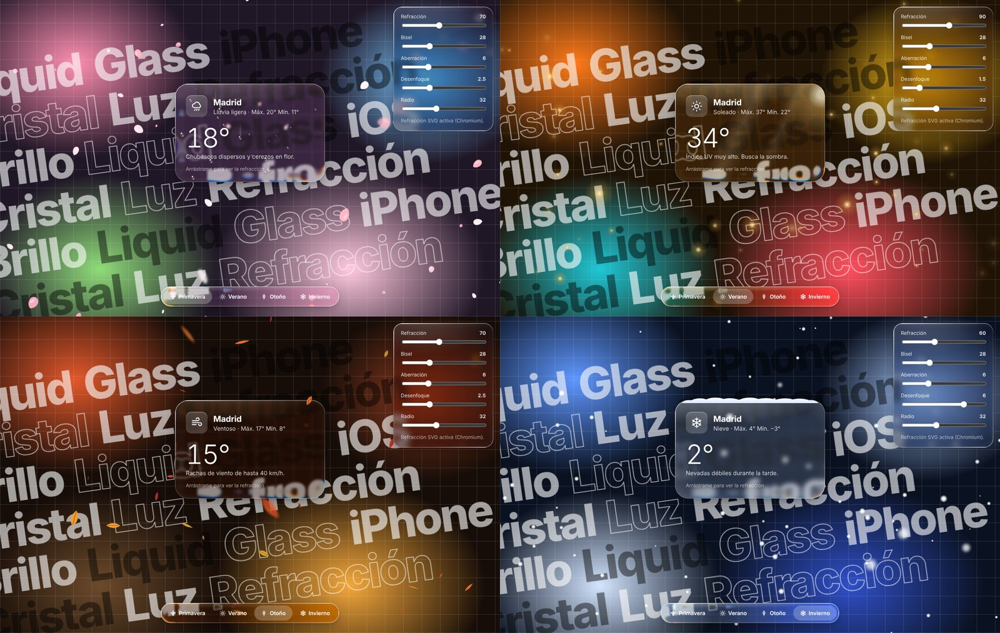

# Liquid Glass (efecto cristal de iPhone)

Efecto de cristal para un recuadro, al estilo de iOS. Incluye la refracción de los bordes, la aberración cromática, el brillo especular y el desenfoque del fondo.


## Uso

```html
<link rel="stylesheet" href="liquid-glass.css">

<div class="glass" id="box">Contenido</div>

<script src="liquid-glass.js"></script>
<script>
  new LiquidGlass(document.getElementById("box"), {
    refraction: 70,  // intensidad de la curvatura del fondo (px)
    bezel: 28,       // ancho del borde que refracta (px)
    aberration: 6,   // separación de colores en el borde (px)
    blur: 2.5,       // desenfoque del fondo (px)
    saturation: 1.6, // saturación del fondo
  });
  // o para todos: LiquidGlass.attachAll(".glass");
</script>
```

Variables CSS personalizables: `--glass-radius`, `--glass-tint`, `--glass-blur` y `--glass-saturate`.

## Estaciones

La demo incluye efectos para las cuatro estaciones (`seasons.js` + `seasons.css`):



| Estación | Partículas | Sobre el cristal |
|---|---|---|
| Primavera | Pétalos de cerezo que giran en 3D | Gotas de lluvia con rastro |
| Verano | Motas de luz que suben y titilan | Destello de sol que se desplaza |
| Otoño | Hojas que caen con ráfagas de viento | Una hoja posada en la esquina |
| Invierno | Nieve con varias profundidades | Escarcha en los bordes, nieve acumulada encima y cristal más esmerilado |

- Las partículas se pintan **detrás** del cristal, así que se ven refractadas a través de él, y unas pocas, grandes y desenfocadas, **delante**, para dar profundidad.
- El puntero aparta las partículas cercanas.
- Al cambiar de estación cambian la paleta del fondo (transición suave con `@property`), el tinte y el brillo del cristal, los parámetros de refracción y el contenido de la tarjeta.
- La estación inicial se toma de la fecha (hemisferio norte) o de `?season=spring|summer|autumn|winter`, y se recuerda la última elegida.
- Con `prefers-reduced-motion` se muestra un fotograma estático.

```js
const fx = new SeasonFX(canvasDetras, canvasDelante);
fx.set("winter");               // o SeasonFX.fromDate()
```

## Cómo funciona

- **CSS (`liquid-glass.css`)**: tinte translúcido, sombras internas, borde especular con degradado enmascarado y brillo superior. Por sí solo da el "frosted glass" clásico de iOS.
- **JS (`liquid-glass.js`)**: calcula la forma del recuadro (rectángulo redondeado) y genera un *mapa de desplazamiento*. Lo aplica con un filtro SVG (`feDisplacementMap`) dentro de `backdrop-filter`, de modo que el fondo se curva en los bordes como una lente. El mapa se regenera si el recuadro cambia de tamaño.

## Compatibilidad

| Navegador | Resultado |
|---|---|
| Chrome / Edge / Opera / Android | Refracción completa |
| Safari / Firefox / iOS | Respaldo: desenfoque + brillo (sin refracción) |

Se respetan `prefers-reduced-transparency` y `prefers-reduced-motion`.

Abre `index.html` para ver la demo, con un recuadro arrastrable y controles en vivo.
